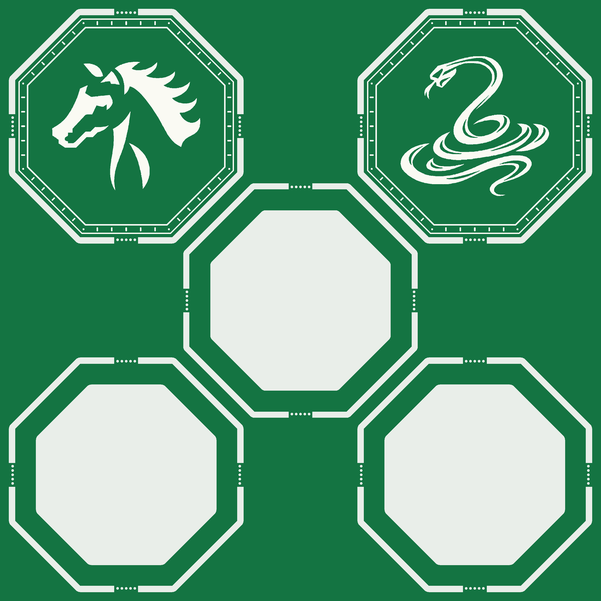

# 马、蛇盖板与三片空心隔层

新增独立的 **100 × 100 mm** 普通 PCB 拼板，绿色阻焊、白色丝印。五片的外形均为 **37 mm 对边八边形**：左上为马盖板，右上为蛇盖板，中间、左下、右下为三片相同的空心隔层。

马、蛇直接复用现有绿白板正面图案，姿态、方向和负形保持一致；图案内没有生肖英文名称。两片盖板保留白色纹理边框和完整闭合的内框。三片隔层为无文字、无铜的绿色环板，内部通过真正的板框铣空图元去除材料，并非白色丝印模拟。

隔层沿用项目既有结构：内窗对边 **30 mm**、内角 **R1 mm**，环壁最窄约 **3.5 mm**。内窗按 2 mm 铣刀考虑；板厚仍须结合现有核心板、光效和叠装首件确认，三片隔层可作为装配用料或备件。

外圈铣槽名义宽 1 mm，每片四个 4 mm 连接桥，每桥五个 Ø0.4 mm 非金属拆板孔，孔距 0.72 mm。孔心继续位于 37 mm 成品参考外形之外 **0.40 mm**，拆板后的局部余量可打磨修平。隔层内窗保持连续闭合。

当前[统一十 PCB 工程](../twelve-options/eda/native/nfc-twelve-options.epro2)中，这个新增页面的原生名称为 **`PCB2`**，UUID 为 `59b61956941700e8`；它的用途为“马、蛇盖板与三片空心隔层”。原九份 PCB 继续保留，本次只去除生肖 A/B 拼板的英文名称并新增此页。

- [普通 Gerber](manufacturing-draft/horse-snake-spacers-green-white-gerber.zip)
- [设计和来源清单](design-manifest.json)、[原生与导出清单](export-manifest.json)
- [几何图元](geometry.json)、[交付检查](delivery-audit.json)、[实际 Gerber 与连板审计](gerber-geometry-audit.json)
- [十二选项展示资料](../../../../output/pdf/十二星座与生肖_拼板展示.pdf)：第 6 页为本拼板。

已保存、关闭重开，DRC 为 0。独立检查核对了 24 条实际铣槽轮廓、100 个 NPTH、三处内窗及整板连通性。制造状态保持 `HOLD_CAM_PHYSICAL_VALIDATION_PENDING`，供应商 CAM、拆板与打磨、板厚和叠装首件尚待确认。
